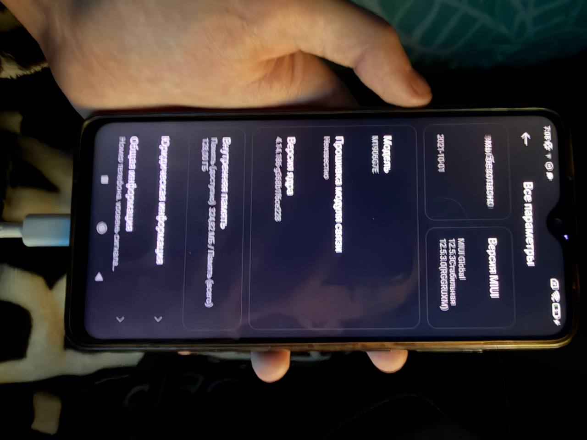
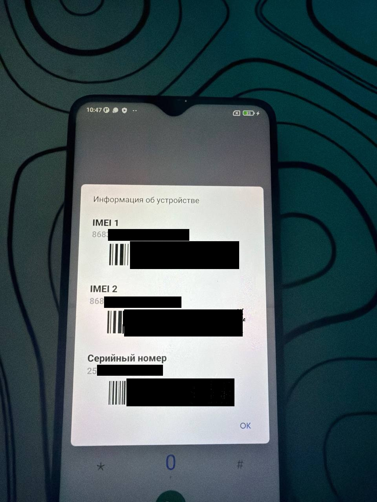

> 🇷🇺 **Для русскоязычных пользователей:** Полная инструкция на русском доступна в [README_ru.md](README_ru.md).

# Redmi Note 8 Pro (begonia) — Baseband & IMEI Restoration Toolkit

[-orange.svg)](https://www.mediatek.com/)
[-blue.svg)](https://mi.com/)
[-brightgreen.svg)]()
[](LICENSE)

A complete toolkit, scripts, and step-by-step methodology to permanently fix modem crash loops, eliminate the AEE storage leak (127 GB of log spam), restore Baseband firmware, and write factory IMEI 1 / IMEI 2 on **Xiaomi Redmi Note 8 Pro** (`begonia` / `M1906G7E`) via hardware **BROM (BootROM)** mode without paid authorization (No-Auth SLA/DAA bypass).

---

## 📱 Target Device Specifications

* **Device Model:** Xiaomi Redmi Note 8 Pro
* **Board Codename:** `begonia` / `M1906G7E`
* **SoC:** MediaTek Helio G90T (`MT6785`), ARM64 architecture
* **Flash Storage:** UFS 2.1 128 GB (`MT128GASAO4U21`)
* **Stock OS:** MIUI Global 12.5.3.0 Stable (`RGGRUXM`), Android 11
* **Kernel Version:** `4.14.186-g368b1f6ce228`
* **Bootloader State:** Unlocked (`unlocked` / `orange state`)

---

## ⚠️ Symptoms & Root Cause (Initial State)

1. **Storage Filled to Capacity (127 GB out of 128 GB):**
   * The MediaTek AEE crash reporter service (`/data/vendor/aee_exp` and `aee_core`) continuously dumped core files and stack traces caused by constant modem panics (`ccci_mdinit`, `md_logger`), filling user storage completely within minutes of boot.
2. **Baseband Version: «Unknown» (`Неизвестно`):**
   * *Settings -> About Phone -> All Specs* displayed *«Unknown»* under Baseband.
   * CCCI modem driver failed to respond to AT commands (`vendor.ril.md_status_from_ccci: stopped/assert`).
3. **Missing IMEI & Cellular Disconnect:**
   * Dialing `*#06#` showed empty IMEI 1 and IMEI 2 fields, with only the serial number displayed.
   * Outgoing calls failed immediately with *«Mobile network not available»* or *«Invalid MMI code»*.
4. **Corrupted NV Storage Headers:**
   * Partitions `nvram`, `nvdata`, and `nvcfg` suffered structural corruption in TOC / calibration headers, preventing the modem subsystem from initializing.

---

## 📸 Restoration Gallery

### 1. Initial State: Baseband Unknown & Modem Crashed


---

### 2. Intermediate State: Baseband Restored (`MOLY.LR13...`)


---

### 3. Final State: IMEI Restored & Radio Transceiver Fully Active


---

## 🛠️ Architecture & Solution Breakdown

On Xiaomi MediaTek smartphones (specifically MT6785), radio parameters rely on a two-tier architecture:
1. **`nvram` (Master RAW image, 64 MB):** Raw block partition containing Table of Contents (TOC), RSA certificates (`CSSD_000`), RF calibration tables (`LD0B_001`), Wi-Fi MAC, and Bluetooth MAC.
2. **`nvdata` (Target ext4 partition, 64 MB):** Formatted with an `ext4` filesystem and mounted by Android at `/mnt/vendor/nvdata`. On first boot, the system daemon `nvram_daemon` compares TOC headers and synchronizes database files from `nvram` into `nvdata`. If `nvdata` already exists with corrupted index files, changes written to `nvram` are ignored!

### Why Standard Methods (MauiMETA / Generic mtkclient) Fail:
- MT6785 on modern security patches disables META mode over Preloader due to USB enumeration timeouts.
- Xiaomi begonia enforces RSA signature verification (`devPubKeyModulus` + `crticalDataSign`) for SIM Slot 1. Restoration requires reconstructing TOC entries signed specifically for the target SoC `chip_id`.

---

## 📋 Step-by-Step Restoration Guide

### Prerequisites:
1. Install Python 3.9–3.12 (check *«Add Python to PATH»* during installation).
2. Install [USBDK](https://github.com/daynix/UsbDk/releases) filter driver or assign `libusb0` via Zadig to `MediaTek USB Port (VCOM)`.
3. Install required Python packages:
   ```cmd
   pip install pyusb pycryptodome
   ```

### Step 1. Wipe Corrupted NV Partitions
Run `1_wipe_corrupted_nv.cmd` (or execute manually):
```cmd
python tools\mtkclient\mtk.py --ptype kamakiri e nvram,nvdata,nvcfg
```
* **Procedure:** Power off the phone completely. Hold both volume buttons (**Vol+** and **Vol-**) and plug in the USB cable.
* `mtkclient` exploits BROM mode via Kamakiri, disables the hardware watchdog, bypasses SLA/DAA authentication, and formats corrupted NV partitions.

---

### Step 2. Generate Valid NVRAM Image with Your Device Identifiers
1. Retrieve your SoC `chip_id` via ADB (phone powered on):
   ```cmd
   adb shell getprop ro.boot.chipid
   ```
2. Copy `tools\mtk_imei\config.example.json` to `tools\mtk_imei\config.txt` and fill in your values:
   ```json
   {
     "patch_cert": 1,
     "device": "begonia",
     "kernel": "4.14.186",
     "chip_id": "0x00000000000000000000000000000000",
     "imei_1": "868368000000001",
     "imei_2": "868368000000002",
     "wifi_mac": "F44E05123456",
     "bt_mac": "000046000001"
   }
   ```
3. Run `2_generate_nvram.cmd`. The script rebuilds the RSA signature blocks, sets up TOC entries, and creates `tools\mtk_imei\out\nvram.img` (exactly 67,108,864 bytes).

---

### Step 3. Flash Restored NVRAM to Device
Run `3_flash_nvram.cmd`:
```cmd
python tools\mtkclient\mtk.py --ptype kamakiri w nvram tools\mtk_imei\out\nvram.img
```
* Power off the phone, hold **Vol+** and **Vol-**, and connect USB. The image writes directly to UFS sector `95616`.

---

### Step 4. Flash Clean NVDATA ext4 Image (Critical Step!)
To trigger `nvram_daemon` to unpack and synchronize parameters from `nvram` into `/mnt/vendor/nvdata`, the `nvdata` partition must be flashed with a pristine ext4 layout.

Run `4_flash_nvdata.cmd`:
```cmd
python tools\mtkclient\mtk.py --ptype kamakiri w nvdata tools\mtk_imei\out\nvdata.img
```
* Hold **Vol+** and **Vol-** and connect USB. The clean ext4 image writes to UFS sector `33160`.

---

## 📡 Verification & Testing

1. Unplug the cable and power on the phone (hold Power for ~10 seconds).
2. Navigate to: **Settings -> About Phone -> All Specs -> Status (General Info)**.
3. Confirm that:
   * Baseband version shows: `MOLY.LR13.R1.TC8.SP.V2.P57` (or your build's active modem)
   * IMEI (Slot 1) and IMEI (Slot 2) are present.
4. **Radio Transceiver Test (Without SIM Card):**
   * Open the Phone dialer, dial `112`, and press Call.
   * An audible dial tone or response from emergency services confirms that RF transceivers, calibration data, and base station registration are fully operational.

---

## 💡 Troubleshooting (FAQ)

* **`Kamakiri2 failed, cache issue :(`:**
  * MT6785 BootROM cache blocks `0xDA` / Kamakiri2 payloads. The scripts in this toolkit enforce `--ptype kamakiri`.
* **mtkclient crash after 7 dots (`...........`):**
  * On Windows 10/11 using `libusb0`, unhandled calls to `libusb_set_option` crash the backend. This toolkit includes patched `usblib.py` and `Port.py` with safe attribute guards and extended port wait timeouts (up to 3 minutes).

---

## 🤝 Credits
- **[bkerler](https://github.com/bkerler/mtkclient)** — for the indispensable mtkclient tool and Kamakiri exploit implementation.
- **[timjosten](https://github.com/timjosten/mtk_imei)** — for the MT6785 certificate generator and NVRAM TOC structures.
